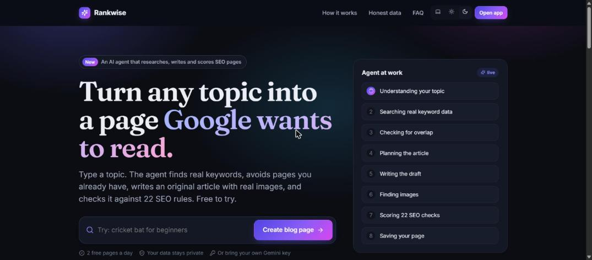
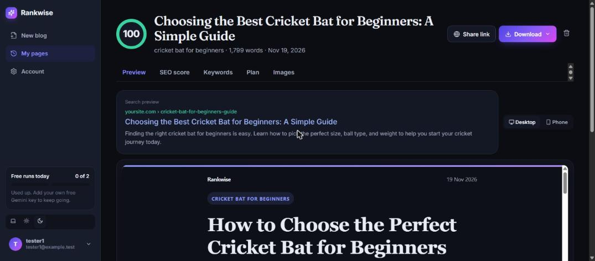

# Rankwise: an AI agent that creates SEO blog pages for any topic

**Live:** https://ai-seo-blog-agent.onrender.com (free Render instance: the first load after idle can take about a minute)

Type a topic. An AI agent researches real keywords, avoids topics you already cover, plans and writes an original article with real images, scores it against 22 transparent SEO checks, and saves a page you can preview, share or download. Free to use: **2 pages per day on the shared Gemini key**, or paste your own free Gemini key for no daily limit.

```
React (Vite) --SSE--> FastAPI --> LangGraph agent --> Gemini (structured output)
                         |        seeds -> research -> dedupe -> plan -> write -> images -> validate -> [repair -> validate] -> save
                         +--> Postgres: users, pages, images, runs        +--> /s/<token> share pages, downloads (HTML, zip, Markdown, JSON)
```

## Screenshots



## What the agent does
| Step | How | Data label |
|---|---|---|
| 1 Seeds (AI) | Turns the topic into 8 phrases a person would search | |
| 2 Research | Live **Google Autocomplete** for each seed (country and language aware), optional **sitemap** of your own site (read-only), **Wikipedia** reference text | **Verified** |
| 3 Duplicate check | Word overlap of every keyword with your site's pages and your earlier pages: `gap` / `partial` / `conflict`. Deterministic, free, explainable | Verified (computed) |
| 4 Plan (AI) | Main + side keywords, a unique angle, slug, audience, intent, H1/H2/H3 outline | Volume, competition, intent are **AI estimates** (low / medium / high, never invented numbers) |
| 5 Write (AI) | Title, meta, article, key takeaways, FAQs, image ideas, sources, next-step box. Rules: no invented statistics, no stock AI phrases | |
| 6 Images | Gemini image generation if the key allows it, else openly licensed photos (Pexels with a key, otherwise Wikimedia Commons) with credit, else a generated cover | |
| 7 Validate | **22 code-based SEO checks** in 4 groups (on-page, content, trust and originality, technical), each with "why it matters" and "how to fix". Score 0-100 | |
| 8 Repair | Only if checks fail: one targeted repair call, then validate again | |
| 9 Save | Page, checks, research and images saved to your account | |

About 3-4 Gemini calls per page. Models fall back automatically (`gemini-3.5-flash`, `3.8-flash`, `3.1-flash-lite`) and a model that just failed is skipped for a few minutes.

## Accounts and privacy
- Sign up with email and password, or **Continue with Google** (when configured). Passwords are hashed with scrypt; sessions are httpOnly, SameSite=Lax cookies.
- **Every query is scoped to the signed-in user.** Another user's page returns 404, tests prove it.
- Pages are private. A page can have an optional unguessable **share link** (hidden from search engines) that can be switched off at any time.
- **Your own Gemini key** is sent over HTTPS to the server only to run your blog. It is never written to the database or logs (a log filter redacts key-like strings, and a test checks it). In the browser it stays in the tab (`sessionStorage`) unless you tick "remember".
- A user can export all their data or delete their account (everything cascades).
- Website field: only public http(s) sites on standard ports; private and loopback addresses are blocked (SSRF protection); read-only GET of robots.txt and sitemaps with size and time limits.

## Run locally
Requirements: Docker Desktop, Node 18+ (Python is only needed inside Docker).

```powershell
copy .env.example .env                       # set GEMINI_API_KEY and POSTGRES_PASSWORD
docker compose --profile dev up -d           # Postgres + the backend (http://127.0.0.1:8000)
cd frontend; npm install; npm run build      # the backend serves frontend/dist
# or for hot reload:  npm run dev   (http://localhost:5173, proxies /api to :8000)
```
Tests (the AI and network are faked, so no Gemini quota is used):
```powershell
docker compose --profile dev run --rm app pytest -q
```

## Environment variables
| Name | Purpose |
|---|---|
| `GEMINI_API_KEY` | Shared key for the free runs. Without it only users with their own key can create pages |
| `LLM_MODEL`, `LLM_FALLBACK_MODELS` | Main model and the fallbacks tried when it is overloaded (503) or out of free quota (429) |
| `DATABASE_URL` | Hosted Postgres URL (production). Locally the `POSTGRES_*` / `DB_*` variables are used |
| `FREE_RUNS_PER_DAY`, `GLOBAL_FREE_RUNS_PER_DAY` | Free runs per user (rolling 24 h) and in total |
| `PUBLIC_URL` | Public address, used for share links and Google redirect (derived from headers if unset) |
| `GOOGLE_CLIENT_ID`, `GOOGLE_CLIENT_SECRET` | Enable Google sign-in. Redirect URI: `<PUBLIC_URL>/api/auth/google/callback` |
| `PEXELS_API_KEY` | Optional free key for better stock photos |

## Deploy (free): Render + Neon
`Dockerfile` and `render.yaml` are included. Create a free Neon database, then set `DATABASE_URL` (with `sslmode=require`) and `GEMINI_API_KEY` in the Render service. The database tables are created on start. The free Render instance sleeps when idle.

## Honest limits
- Search volume and competition are AI estimates: there is no free official source. They are labelled, never shown as exact numbers.
- Free Gemini models are sometimes busy; the agent retries other models, and a run can still occasionally fail with a clear message.
- Gemini image generation is not in the free tier, so free runs use openly licensed photos or generated covers.
- No password reset by email yet (free hosting blocks SMTP); Google sign-in avoids the need.
- Review every page before publishing. Nothing here guarantees a ranking.
